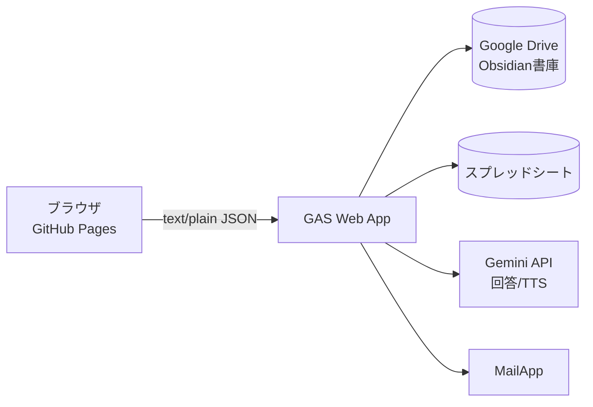

# 📚 Obsidian書庫AI（v1.1.0）

Google Drive に同期した Obsidian 書庫（`.md`）を検索し、Gemini がまとめて答える Web アプリです。
フロントエンドは GitHub Pages、バックエンドは Google Apps Script（GAS）で、**維持費は0円**です。

---

## 1. システム構成図

```
 ┌──────────────── 利用者のブラウザ（PC / スマホ） ────────────────┐
 │  GitHub Pages: index.html / style.css / app.js / config.js     │
 │   ・音声入力（Web Speech API, continuous + 自動再接続）          │
 │   ・TTS再生（PCM→WAV変換）・Earth Studio用JSON/KML生成           │
 │   ・LINE共有（line.me/R/msg/text/?…）・URLコピー                │
 └───────────────┬────────────────────────────────────────────────┘
                 │ POST (Content-Type: text/plain, JSON)  ※APIキーは通らない
                 ▼
 ┌──────────────── Google Apps Script（ウェブアプリ） ─────────────┐
 │  Code.gs                                                        │
 │   ・会員認証（仮パスワード / ハッシュ化 / セッション / ロック）    │
 │   ・索引作成（1時間ごと差分）→ NoteIndex シート                  │
 │   ・検索（キーワード解析→スコアリング→抜粋）                     │
 │   ・Gemini 呼び出し（KEY_1→KEY_2→KEY_3 自動フォールバック）      │
 │   ・ナレッジカードと公開権限の管理                               │
 └──┬──────────────┬──────────────────┬───────────────┬───────────┘
    │              │                  │               │
    ▼              ▼                  ▼               ▼
 Google Drive   スプレッドシート     Gemini API       MailApp
 (Obsidian書庫)  Users/Sessions/     ・回答生成        仮パスワード
  .md ファイル    Cards/NoteIndex/    ・クエリ解析      メール送信
                  Logs               ・TTS（音声）
```



### ファイル構成

```
obsidian-shoko-ai/
├── index.html      画面（認証・質問・管理一覧・届いた回答・ガイド・設定）
├── style.css       レスポンシブ・大きめ文字
├── app.js          フロントエンドの全処理
├── config.js       GAS URL・アプリ名・バージョン（ここだけ書き換え）
├── .gitignore
├── README.md
└── gas/
    ├── Code.gs           GASバックエンド（コピペ用）
    └── appsscript.json   マニフェスト（任意）
```

---

## 2. Google Drive / スプレッドシートの初期セットアップ

### 2-1. Obsidian書庫フォルダのIDを調べる
1. Google Drive で Obsidian 書庫のフォルダ（サブフォルダ含む）を開く
2. URL `https://drive.google.com/drive/folders/XXXXXXXX` の **XXXXXXXX** が `VAULT_FOLDER_ID`

> `.obsidian` `.trash` `.git` フォルダは自動で除外されます（`EXCLUDE_FOLDERS` で変更可）。

### 2-2. GASプロジェクトを作る
1. https://script.google.com/ →「新しいプロジェクト」→ 名前を「Obsidian書庫AI」に
2. `Code.gs` の中身をすべて消し、本リポジトリの `gas/Code.gs` を貼り付けて保存
3. （任意）「プロジェクトの設定」→「"appsscript.json" マニフェスト ファイルをエディタで表示する」にチェック → `gas/appsscript.json` を貼り付け
4. 関数 `setup` を選んで ▶実行 → 権限を承認
   - スプレッドシート「Obsidian書庫AI_データ」が自動作成され、`SPREADSHEET_ID` が保存されます
   - 既存のスプレッドシートを使う場合は、先に `SPREADSHEET_ID` をプロパティに入れてから実行
   - 1時間ごとの索引更新トリガー（`buildIndex`）も登録されます

### 2-3. スクリプトプロパティ一覧
「プロジェクトの設定」→「スクリプト プロパティ」で設定します。

| プロパティ名 | 必須 | 既定値 | 説明 |
|---|---|---|---|
| `VAULT_FOLDER_ID` | ✅ | – | Obsidian書庫フォルダのID |
| `GEMINI_API_KEY_1` | ✅ | – | 第1優先APIキー |
| `GEMINI_API_KEY_2` | | – | 第2優先（429・利用不可時に自動切替） |
| `GEMINI_API_KEY_3` | | – | 第3優先 |
| `APP_URL` | 推奨 | – | GitHub PagesのURL（メール本文のログインリンク） |
| `SPREADSHEET_ID` | 自動 | – | `setup()` が自動設定 |
| `PASSWORD_PEPPER` | 自動 | ランダム | パスワードハッシュ用。**後から変えると全員ログイン不可になる** |
| `GEMINI_MODEL` | | `gemini-4-hydrogen` | 回答・解析用モデル（Geminiアプリの「4 Hydrogen」） |
| `GEMINI_MODEL_FALLBACK` | | `gemini-3.8-flash` | 上のモデルが使えない時に自動で切替える予備（空欄で無効） |
| `GEMINI_THINKING_LEVEL` | | `medium` | 回答時の思考レベル `low`/`medium`/`high`（Gemini 4は`xhigh`も可）。3/4系のみ送信 |
| `GEMINI_TTS_MODEL` | | `gemini-3.8-flash-tts` | 読み上げ用モデル |
| `GEMINI_TTS_MODEL_FALLBACK` | | `gemini-2.5-flash-preview-tts` | 読み上げの予備モデル |
| `GEMINI_TTS_VOICE` | | `Kore` | 既定の声 |
| `APP_NAME` | | `Obsidian書庫AI` | メール差出人名 |
| `ADMIN_EMAILS` | | – | 管理者メール（カンマ区切り）。**最初の登録者は自動で管理者** |
| `SEARCH_ALLOWED` | | `all` | `admin` にすると書庫検索は管理者のみ（家族は共有閲覧だけ） |
| `SESSION_HOURS` | | `168` | ログイン有効時間（時間） |
| `MAX_NOTES` | | `8` | 1回の回答に使う最大ノート数 |
| `MAX_CONTEXT_CHARS` | | `60000` | Geminiに渡す抜粋の最大文字数 |
| `EXCLUDE_FOLDERS` | | `.obsidian,.trash,.git,node_modules` | 索引から除外するフォルダ名 |
| `INDEX_LAST_RUN` | 自動 | – | 最終索引結果（自動記録） |

> ⚠ **APIキーは絶対に config.js や GitHub に書かないこと。** GASのスクリプトプロパティだけに保存します。

### 2-4. スプレッドシートのシート・列定義（`setup()` が自動作成）
全セルは「書式なしテキスト」（数式として解釈されない）です。

**Users**（会員）
| 列 | 内容 |
|---|---|
| userId | `u_` + ランダム |
| email | 小文字化したメール |
| nickname | ニックネーム |
| passwordHash | SHA-256 を300回反復（ソルト＋ペッパー） |
| salt | ユーザー別ソルト |
| mustChangePassword | `TRUE`=仮パスワード状態（変更まで機能制限） |
| status | `active` / `disabled`（手で`disabled`にすると利用停止） |
| role | `admin` / `member` |
| failedCount / lockedUntil | 5回失敗で15分ロック |
| agreedAt | 免責事項に同意した日時 |
| createdAt / updatedAt / lastLoginAt | 日時（ISO） |

**Sessions**：token / userId / createdAt / expiresAt

**Cards**（ナレッジカード＝回答）
| 列 | 内容 |
|---|---|
| cardId | `c_` + UUID（共有URLのID） |
| ownerId | 作成者 userId |
| title / question / answer | タイトル・質問・回答（Markdown） |
| narration | 読み上げ用の純粋な本文（前処理済み） |
| sources | 出典ノート JSON `[{title,path,fileId}]` |
| places | 位置情報 JSON `[{name,lat,lng,description}]` |
| isShared | `FALSE`（作成直後は必ず非公開）/ `TRUE` |
| sharedWith | 公開先 userId の JSON 配列（非公開にしても選択は残る） |
| createdAt / updatedAt | 日時 |

**NoteIndex**（書庫の索引）：fileId / path / title / tags / modified / size / content（先頭45,000字）/ indexedAt

**Logs**：timestamp / userId / action / detail（APIキー切替の記録もここ）

### 2-5. 索引を作ってテスト
GASエディタで以下を順に実行し、「実行ログ」を確認します。
1. `testGemini` → 「接続テスト成功」
2. `testTts` → 「TTS OK」
3. `testMail` → 自分宛にメールが届く
4. `rebuildIndexFull` → NoteIndex にノートが並ぶ（数千件なら数分。時間切れ分は次の定期実行で続きを処理）
5. `testCleanNarration` → メタ発言や記号が消えた文が出ればOK

---

## 3. GASをウェブアプリとして公開
1. 右上「デプロイ」→「新しいデプロイ」→ 種類「ウェブアプリ」
2. 次のユーザーとして実行：**自分**／アクセスできるユーザー：**全員**
3. 「デプロイ」→ 表示された **ウェブアプリURL（…/exec）** をコピー
4. コードを修正したら「デプロイを管理」→ 鉛筆 → バージョン「新バージョン」で更新（URLは変わりません）

---

## 4. GitHub Pages へのデプロイ手順
1. GitHub で新規リポジトリ作成（例：`obsidian-shoko-ai`）
2. `config.js` の `GAS_URL` に 3. のURLを貼る（空のままでも、画面の「⚙ 設定」から入力可）
3. ファイルをアップロード（`gas/` フォルダも入れてOK。APIキーは含まれていません）
   ```bash
   git init && git add . && git commit -m "v1.1.0"
   git branch -M main
   git remote add origin https://github.com/kenken6291/obsidian-shoko-ai.git
   git push -u origin main
   ```
4. リポジトリの Settings → Pages → Source「Deploy from a branch」→ `main` / `(root)` → Save
5. 数分後 `https://kenken6291.github.io/obsidian-shoko-ai/` で公開
6. GASのスクリプトプロパティ `APP_URL` に上記URLを設定（メールのリンク用）

> バージョンを上げるときは `config.js` の `APP_VERSION` と `gas/Code.gs` の `APP_VERSION` を揃えて更新してください。
> `.gitignore` で `*.md`（README以外）を除外しているので、書庫のノートを誤って公開する心配がありません。

---

## 5. 動作確認チェックリスト

### 設定・表示
- [ ] ヘッダーとフッターに `v1.1.0` が表示される
- [ ] `config.js` の GAS_URL が空のとき、設定モーダルが開き、入力・接続テスト・保存ができる
- [ ] PC（横長）とスマホ（縦長）で崩れない／「⚙ 設定」で文字サイズを変えられる

### 会員認証
- [ ] 同意チェックを入れるまで「同意して登録する」が押せない
- [ ] 登録後、仮パスワードのメールが届く（最初の登録者が管理者になる）
- [ ] 仮パスワードでログイン → パスワード変更画面に強制遷移し、他の機能が使えない
- [ ] 本パスワード（8文字以上・英字＋数字）に変更後、メイン画面に入れる
- [ ] すべてのパスワード欄で 👁 / 🙈 の表示切替ができる（ログイン・変更画面）
- [ ] 「パスワードを忘れた方」→ 新しい仮パスワードが届き、ログイン後に再設定を求められる
- [ ] 5回続けて失敗すると15分ロックされる
- [ ] スプレッドシートのパスワードが平文で保存されていない（passwordHash）

### 検索・要約
- [ ] 質問すると出典ノート名つきの回答が表示される（本文中に【出典: ノート名】）
- [ ] 書庫にない内容は「記載がありません」と答える
- [ ] 作成直後のカードが「🔒 非公開（自分のみ）」になっている

### 音声入力
- [ ] 🎤 を押して話すと入力欄に文字が追記される
- [ ] 途中で5〜10秒黙っても止まらず、続けて話すと追記される
- [ ] 「⏹ 停止」または「送信して調べる」でのみ終了する

### TTS（読み上げ）
- [ ] 「🔊 読み上げ」で音声が流れる／一時停止・停止・声の変更ができる
- [ ] 「はい、読み上げます」などの前置きや記号・出典表記が読まれない
- [ ] iPhone Safari でも再生できる

### Google Earth 連携
- [ ] 地名を含む質問で「🌏 地図・Google Earth」欄が表示される
- [ ] 「Google Earthで見る」でその場所へ移動する
- [ ] カメラJSON・KMLがダウンロードでき、KMLは Google Earth でツアー再生できる

### 限定公開・共有
- [ ] マイナレッジで公開先を選び、スイッチで公開／非公開をワンクリックで切り替えられる
- [ ] 公開先に選んだ会員の「届いた回答」に表示され、読み上げもできる
- [ ] 公開先以外の会員が共有URLを開くと「権限がありません」と表示される
- [ ] 「LINEで送る」でLINEが開き、タイトルとURLが入っている
- [ ] 未ログインで共有URLを開く → ログイン（仮PWなら変更）後に該当カードが開く
- [ ] 非公開に戻すと相手からすぐ見えなくなる

### APIフォールバック・セキュリティ
- [ ] `GEMINI_API_KEY_1` を無効な値にしても KEY_2 で回答が出る（Logs に `geminiFallback`）
- [ ] GitHub リポジトリ内に APIキーが含まれていない（`git grep AIza` で何も出ない）

---

## 6. 補足・制約
- **メール送信上限**：無料Googleアカウントは1日100通程度（`MailApp.getRemainingDailyQuota()`）。
- **索引**：DriveAppでフォルダを巡回するため、ノートが数千件を超えると初回は複数回に分かれます（自動で続きを処理）。
- **検索方式**：キーワード（Geminiで同義語・表記ゆれも抽出）によるスコアリングです。ベクトル検索ではありません。
- **座標**：場所の緯度経度はGeminiの知識による概算です。Earth Studio のカメラJSONは本アプリ独自形式で、Earth Studioへは手入力（ファイル内 `howToUse` 参照）、プレビューはKMLで行います。
- **モデル名**：Geminiのモデル名は随時変わるため、スクリプトプロパティで最新名に差し替えてください。
- **自動切替の順番**：各モデルの中で APIキー 1→2→3 を試し、全滅したら予備モデルで再度 1→2→3。400エラー時は思考設定・JSONスキーマを外して同じモデルで1回再試行します。どのモデルで答えたかは Logs シートに記録されます。

### Gemini のモデル対応表（2026年11月時点）
| Geminiアプリの表示 | APIのモデル名 | 料金・用途 |
|---|---|---|
| 日々の暮らしをサポート：4 Hydrogen | `gemini-4-hydrogen` | 速くて安い。**本アプリの推奨** |
| 詳細な分析：4 Neon | `gemini-4-neon` | より賢いが**有料プランのみ**（無料枠なし） |
| コードと複雑な作業：4 Carbon | `gemini-4-carbon` | 最上位。高コスト。本用途には過剰 |
| （従来）3.8 Flash | `gemini-3.8-flash` | 安定版。予備に最適 |
| 読み上げ | `gemini-3.8-flash-tts` / `gemini-3.8-flash-lite-tts` | Lite は安く速い |

既存環境は GAS で `upgradeModelSettings()` を1回実行すると推奨値に更新されます。
- **プライバシー**：家族に書庫の検索まで許可したくない場合は `SEARCH_ALLOWED=admin` にしてください（家族は共有された回答の閲覧・読み上げのみ）。
